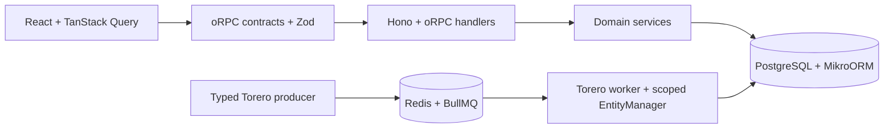

# Fullstack Template

An opinionated TypeScript workspace for building apps with a contract-first API, PostgreSQL, and typed background jobs. Three independently deployable React apps share contracts, UI components, environment helpers, and logging.

**Node 26 · pnpm 12 · TypeScript 7 · React 19 · Vite 8 · oRPC · MikroORM 7 · Torero 0.2 · BullMQ 6**

The examples are deliberately small enough to replace. The user app demonstrates real database writes, typed validation errors, and session recovery; the admin app checks API availability; the landing page introduces the project. Anonymous **demo sessions are not authentication** and are disabled in production. Add your identity provider and authorization rules before exposing protected application features.

## Start building

Requirements: Node **26.12.0**, pnpm **12.14.0**, and Docker Compose v2. The exact toolchain is recorded in `.node-version`, `.tool-versions`, and `package.json`. Install pnpm with `npm install --global pnpm@12.14.0` if needed.

```sh
git clone https://github.com/josehdez01/monorepo-fillstack-template.git my-app
cd my-app
pnpm install
pnpm setup
pnpm dev
```

`setup` copies missing environment files, waits for PostgreSQL and Redis, and applies migrations. It preserves existing `.env.local` files. `dev` starts the API and user app; `pnpm dev:all` also starts the landing and admin apps.

| Application            | Address                                                    |
| ---------------------- | ---------------------------------------------------------- |
| User app               | http://localhost:5175                                      |
| Admin app              | http://localhost:5174                                      |
| Landing page           | http://localhost:5173                                      |
| API health / readiness | http://localhost:3000/health · http://localhost:3000/ready |

The local services bind to loopback. If ports 5432 or 6379 are occupied, set `POSTGRES_PORT` / `REDIS_PORT` when starting Compose and update `backend/.env.local` to match. `pnpm infra:down` stops services without deleting data. PostgreSQL 18 uses a new `pgdata18` volume; upgrading an existing PostgreSQL 16 checkout requires a dump/restore rather than reusing its data directory.

To rename the workspace scope, run `pnpm mint -- --scope @acme --dry`, inspect the planned scope, then run without `--dry` and run `pnpm install` again. Alternatively, use GitHub's **Use this template** action to create your repository first.

## Architecture



- `contracts/`: browser-safe RPC schemas, branded IDs, and queue contracts. No backend imports.
- `backend/`: Hono transport, thin RPC handlers, domain services, repositories, and explicit runtime ownership.
- `frontend/{user_app,admin_app,landing_page}/`: Vite applications with file-based TanStack Router and typed oRPC clients.
- `packages/ui/`: shared accessible application shell, shadcn/ui and RetroUI components. Import individual components to keep bundles small.
- `packages/{env,logger}/`: validated runtime configuration and structured logging with credential redaction.
- `packages/e2e/`: browser tests against the real API and disposable PostgreSQL/Redis.

Development resolves workspace source through package export conditions; production resolves built JavaScript. Shared packages are built before consumers. The root typecheck includes every app and production UI component. Exact dependency versions live in the pnpm workspace catalog, so shared versions and generated apps stay aligned.

See [architecture decisions](REPO_STRUCTURE.md), [RPC patterns](backend/src/rpc/README.md), [testing](backend/docs/testing.md), and [deployment](docs/deployment.md).

## Commands

| Command                                                        | Purpose                                                                    |
| -------------------------------------------------------------- | -------------------------------------------------------------------------- |
| `pnpm check`                                                   | Lint, format check, typecheck, unit tests, production build                |
| `pnpm test`                                                    | Unit and component tests; no external services required                    |
| `pnpm test:generators`                                         | Generate all five slices in a separate workspace, then build and typecheck |
| `pnpm test:integration`                                        | Disposable PostgreSQL/Redis, migrations, real RPC and workers              |
| `pnpm test:e2e`                                                | Disposable services, built backend, real browser flows                     |
| `pnpm --filter @template/e2e exec playwright install chromium` | Install the local browser once                                             |
| `pnpm env:doctor`                                              | Validate environment wiring without printing credentials                   |
| `pnpm lint`                                                    | Apply lint and formatting fixes                                            |
| `pnpm audit`                                                   | Check the full dependency graph for known vulnerabilities                  |

Integration and browser runs allocate their own Compose project and random database/Redis ports, then remove their containers on completion. They never reset your application database. Browser tests use API port 4300 and app ports 5173–5175, so stop local app servers first.

CI runs the same checks on PRs and `master`, including real database/queue tests and Chromium. Dependency updates are proposed weekly. oRPC stays on the latest stable release; version 2 is currently a prerelease.

## Add a feature

Start with a schema in `contracts/src/orpc`, implement it in `backend/src/rpc/routers`, then consume its inferred client in a frontend. Put business rules in a service and let the database enforce uniqueness. Translate expected failures into declared contract errors; never return ORM entities directly.

Generators provide compatible starting points:

```sh
pnpm gen package --args billing-utils
pnpm gen app --args customer-portal
pnpm gen db-entity --args invoice
pnpm gen feature --args invoices
pnpm gen queue --args send-receipt
```

Package and app generators use the shared dependency catalog. Entity generation updates the explicit registry. Feature generation registers its contract and router. Queue generation creates a Torero contract and implementation; add them to the two queue routers before publishing. After adding a package, run `pnpm install` and `pnpm build` to generate routes and verify its wiring.

For entity changes, generate and review a migration, then apply it:

```sh
pnpm --filter @template/backend db:migrate:create
pnpm --filter @template/backend db:migrate:up
```

The sample schema is migration-backed. Keep its history when evolving an existing database; new projects can replace the sample entities and create a fresh initial migration before their first deployment.

## Background jobs

`contracts/src/queues/sum.ts` defines the portable contract; `backend/src/queues/sum-queue.ts` implements it. Jobs get a fresh MikroORM request context and scoped logger. Producers and workers use the same queue prefix, and shutdown drains requests and jobs before closing the ORM.

- `ROLE=all`: API and workers together for local development or a small deployment.
- `ROLE=api`: API and producer connections only.
- `ROLE=worker`: workers only, without an HTTP listener.

With `pnpm dev` running, try `pnpm --filter @template/backend jobs:demo` to publish a job and wait for its result.

Publish through the queue runtime's inferred `jobs` tree. Use stable job IDs or deduplication where appropriate, and make external side effects idempotent. A job timeout signals cooperative cancellation; it does not roll back a database transaction or undo an external request. A database write followed by queue publication is not atomic; use an outbox when that guarantee matters.

## Contributing

Run `pnpm check`, `pnpm test:integration`, and `pnpm test:e2e` before opening a PR. Include a regression test for behavior changes and keep the documented clean-clone flow working. [Security reporting](SECURITY.md) · [Code of conduct](CODE_OF_CONDUCT.md) · [MIT license](LICENSE).
